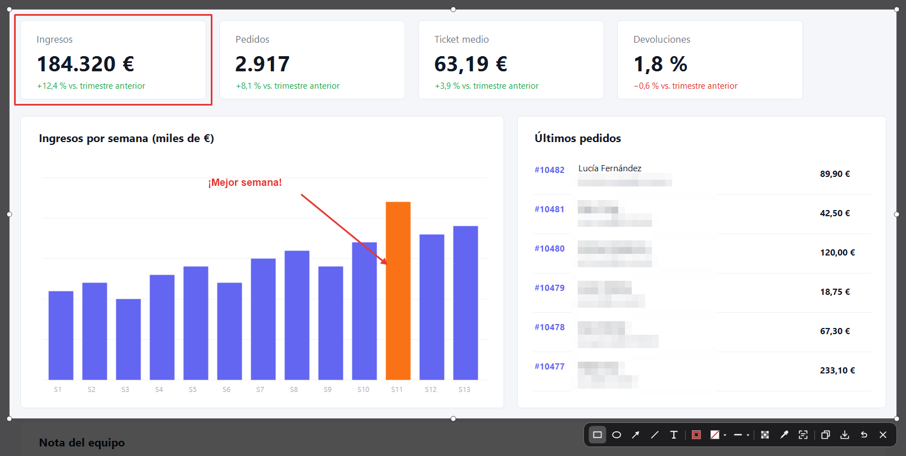
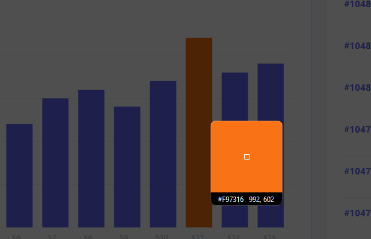
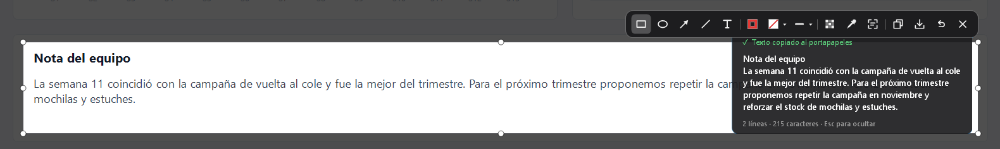

<p align="center">
  
</p>

<h1 align="center">Trazo</h1>

<p align="center">
  Capturas de pantalla con anotaciones, cuentagotas y reconocimiento de texto para Windows.<br>
  Ligera, sin conexión a internet (salvo cuando tú buscas actualizaciones) y sin nada ejecutándose en segundo plano más allá de su icono en la bandeja.
</p>

<p align="center">
  
</p>

---

## Características

- **Captura con un atajo** (por defecto <kbd>Ctrl</kbd>+<kbd>Alt</kbd>+<kbd>S</kbd>). Funciona con varios monitores. Doble clic en el icono de la bandeja para abrir la configuración.
- **Anotaciones** sobre la zona elegida: flechas, líneas, rectángulos, elipses y texto, con color de borde, relleno, grosor, fuente y tamaño.
- **Pintar flecha**: dibuja a mano el recorrido de una flecha y Trazo lo endereza en tramos rectos, con esquinas en ángulo recto o redondeadas. Está en el mismo botón que la flecha normal: su desplegable elige entre Flecha, Recto y Redondeado.
- **Pixelar** una parte de la captura para ocultar datos.
- **Reconocimiento de texto (OCR)**: lee el texto de la zona y lo copia al portapapeles, con el motor de OCR que incluye Windows.
- **Cuentagotas**: copia el color de cualquier píxel en formato `#RRGGBB`.
- **Copiar o guardar** la captura con un solo atajo.
- **Redimensionar o mover la zona** después de elegirla, arrastrando sus bordes o tiradores, o el botón de mover que aparece junto a una de sus esquinas.
- **Reglas y guías de alineación** (<kbd>Ctrl</kbd>+<kbd>R</kbd> o desde la configuración): reglas en los bordes de la zona y líneas de color que aparecen al mover o redimensionar un elemento ya dibujado cuando queda centrado o alineado con la zona u otros elementos, a los que se ajusta al pasar cerca. Con <kbd>Alt</kbd> pulsado se mueve libremente.
- **Esquinas redondeadas y borde** opcionales en la imagen copiada o guardada (tres tamaños de cada uno y el color del borde), desde la configuración.
- Recuerda la última herramienta y el último estilo usados, y permite cambiar el atajo e iniciar con Windows desde su configuración.
- **Ayuda y actualizaciones** desde la configuración y el menú de la bandeja: una ventana con todos los atajos de teclado y la búsqueda de una versión nueva.
- **Aviso de versiones nuevas** (opcional, desactivado por defecto; se elige al instalar y se cambia en la configuración): Trazo lo comprueba como mucho una vez al día, empezando 5 minutos después de arrancar, y muestra un aviso discreto. Nunca se actualiza solo: desde el aviso puedes ver la versión y decidir si instalarla.
- El icono de la bandeja se adapta a la barra de tareas clara u oscura.

| Cuentagotas | Reconocimiento de texto |
|---|---|
|  |  |

## Atajos

| Acción | Atajo |
|---|---|
| Hacer una captura | <kbd>Ctrl</kbd>+<kbd>Alt</kbd>+<kbd>S</kbd> (configurable) |
| Flecha · Línea · Rectángulo · Elipse · Texto | <kbd>A</kbd> · <kbd>L</kbd> · <kbd>R</kbd> · <kbd>E</kbd> · <kbd>T</kbd> |
| Pintar flecha (pulsa otra vez para alternar entre recto y redondeado) | <kbd>F</kbd> |
| Pixelar | <kbd>P</kbd> |
| Cuentagotas | <kbd>I</kbd> |
| Leer texto (OCR) | <kbd>O</kbd> |
| Cambiar el grosor (o el tamaño del texto, con la herramienta Texto o un texto seleccionado) | <kbd>Ctrl</kbd>+rueda del ratón |
| Mover el elemento seleccionado (4 px) | Flechas |
| Mover el borde derecho (<kbd>←</kbd>/<kbd>→</kbd>) o inferior (<kbd>↑</kbd>/<kbd>↓</kbd>) del elemento seleccionado (4 px; en un texto, cambia el tamaño de la letra) | <kbd>Mayús</kbd>+flechas |
| Mostrar u ocultar reglas y guías de alineación | <kbd>Ctrl</kbd>+<kbd>R</kbd> |
| Deshacer | <kbd>Ctrl</kbd>+<kbd>Z</kbd> |
| Borrar el elemento seleccionado | <kbd>Supr</kbd> |
| Duplicar el elemento seleccionado | <kbd>Ctrl</kbd>+<kbd>D</kbd> |
| Copiar y cerrar | <kbd>Ctrl</kbd>+<kbd>C</kbd> o <kbd>Intro</kbd> |
| Copiar el color bajo el cursor y cerrar (antes de elegir zona) | <kbd>Ctrl</kbd>+<kbd>C</kbd> |
| Guardar como imagen | <kbd>Ctrl</kbd>+<kbd>S</kbd> |
| Cerrar sin guardar | <kbd>Esc</kbd> |

Con <kbd>Mayús</kbd> las flechas y líneas quedan horizontales o verticales, los rectángulos cuadrados y las elipses círculos. Al pintar una flecha, <kbd>Mayús</kbd> hace que todos los tramos sean horizontales o verticales, sin diagonales.

Para mover un elemento, haz doble clic sobre él para seleccionarlo y arrástralo (o mantén pulsado el segundo clic y arrastra). Un rectángulo, elipse o zona pixelada seleccionada muestra 8 tiradores, una flecha o línea uno en cada extremo y una flecha pintada uno en cada punto clave: arrástralos para cambiar su tamaño o dirección (en una flecha pintada, los tramos horizontales y verticales lo siguen siendo). Doble clic en un texto ya seleccionado para editarlo.

## Instalación

1. Descarga el instalador `Trazo-<versión>.msi` desde la sección **Releases**.
2. Ábrelo y elige si instalarlo solo para ti (sin permisos de administrador) o para todos los usuarios del equipo.
3. El asistente pregunta si quieres que Trazo te avise de las versiones nuevas (desmarcado por defecto). Puedes cambiarlo después en la configuración.

> [!NOTE]
> El instalador no está firmado digitalmente, así que Windows puede mostrar el aviso *"Windows protegió su PC"*. Para continuar, pulsa **Más información → Ejecutar de todas formas**.

**Requisitos:** Windows 10 (versión 1903 o posterior) o Windows 11. Usa .NET Framework 4.8, que ya viene incluido en Windows.

**Actualizar:** pulsa **Buscar actualizaciones…** en el menú del icono de la bandeja o en la configuración. Trazo consulta las Releases de GitHub y, si hay una versión nueva, te muestra sus novedades; si aceptas, descarga el instalador y lo abre. También puedes abrir a mano el instalador de la versión nueva: detecta la que tienes, la sustituye y conserva tu configuración.

**Aviso de versiones nuevas:** si activas **Comprobar actualizaciones** en la configuración (o lo marcas al instalar), Trazo consulta GitHub como mucho una vez al día, empezando 5 minutos después de arrancar, y te avisa con una notificación discreta cuando hay una versión nueva. Viene desactivado. Solo avisa: nunca descarga ni instala nada sin que lo confirmes.

Para publicar una versión, crea una Release en GitHub con la etiqueta `v<versión>` (por ejemplo `v1.2.0`) y adjunta el archivo `Trazo-<versión>.msi`.

**Desinstalar:** desde *Configuración → Aplicaciones → Aplicaciones instaladas*. Trazo pregunta si quieres borrar también tu configuración (`%AppData%\Trazo\settings.json`).

## Consumo de recursos

Comparativa medida en el mismo equipo (Intel Core i5-14500, 32 GB de RAM, Windows 11, dos monitores de 1920×1080) con Lightshot y la herramienta Recortes de Windows:

| | Trazo | Lightshot | Recortes de Windows |
|---|---|---|---|
| RAM en reposo | **1–8 MB** | 27–31 MB | 0 MB (sin proceso hasta que se usa) |
| RAM con la captura abierta | 88–102 MB | **63 MB** | 176–200 MB |
| RAM 10 s después de cerrar la captura | **4 MB** | 47 MB | 184 MB (se queda en memoria) |
| Espacio en disco | **0,2 MB** | 5,3 MB | 586 MB |
| Tareas en segundo plano | **Ninguna** | Actualizador cada 4 h | Ninguna propia |

Trazo devuelve a Windows la memoria de la captura en cuanto se cierra y no gasta CPU mientras espera el atajo. El informe completo, con la metodología y sus limitaciones, está en [docs/Comparativa-recursos.pdf](docs/Comparativa-recursos.pdf).

## Compilar desde el código

Necesitas Windows con el [SDK de .NET](https://dotnet.microsoft.com/download) y el paquete de destino de .NET Framework 4.8 (se instala con Visual Studio o desde la [página de descargas de .NET Framework](https://dotnet.microsoft.com/download/dotnet-framework/net48)).

```powershell
# Aplicación
dotnet build Trazo.csproj -c Release

# Instalador (publica la aplicación y genera installer\bin\x64\Release\Trazo-<versión>.msi)
dotnet build installer\Trazo.Installer.wixproj -c Release
```

La versión se cambia en `installer\Trazo.Installer.wixproj` (`AppVersion`) y en `Trazo.csproj` (`Version`). Para que el instalador actualice una versión anterior, la nueva tiene que ser mayor.

### Logo e iconos

El logo se diseña en [`assets/Trazo-simbolo.ai`](assets/Trazo-simbolo.ai). Los iconos de la aplicación y de la bandeja (`Trazo.ico`, `TrazoTray.ico`, `TrazoTrayBlack.ico`) y el logo de este README se generan a partir de él.

Las imágenes del instalador (fondos, logo, botones) se regeneran solas al compilar el instalador; ver [installer/README.md](installer/README.md).

## Estructura del proyecto

| Ruta | Contenido |
|---|---|
| `Program.cs`, `TrayContext.cs` | Arranque, icono de la bandeja y atajo global |
| `Updater.cs`, `InstallerLauncher.cs` | Búsqueda de actualizaciones en las Releases de GitHub y apertura del instalador |
| `UpdateToast.cs` | Aviso discreto de versión nueva |
| `TrazoMessage.cs` | Mensajes con el estilo de Trazo (por ejemplo, los de las actualizaciones) |
| `DarkMenu.cs` | Menú oscuro del icono de la bandeja |
| `ShortcutsForm.cs` | Ventana de atajos de teclado |
| `CaptureOverlay.cs`, `Shapes.cs` | Pantalla de captura, herramientas y formas |
| `OcrService.cs` | Reconocimiento de texto con el OCR de Windows |
| `SettingsForm.cs`, `AppSettings.cs` | Configuración y su almacenamiento en `%AppData%\Trazo` |
| `Icons.cs` | Iconos de la barra de herramientas, dibujados por código |
| `installer/` | Instalador MSI (WiX Toolset 5) con el aspecto de Trazo; `installer/art/` genera sus imágenes y `installer/titlebar/` oscurece su barra de título |
| `assets/` | Logo fuente |
| `docs/` | Informe de consumo de recursos, logo y capturas del README |

## Licencia

Trazo tiene el código visible, pero **no es software libre**. Puedes descargarlo, usarlo, hacer un fork, compilarlo y depurarlo, pero no puedes usarlo con fines comerciales ni distribuirlo con otro nombre o como trabajo propio. Los términos completos están en [LICENSE](LICENSE). Para cualquier otro uso, contacta con el autor.

## Autor

© 2026 [Antidecn](https://github.com/antidecn)
